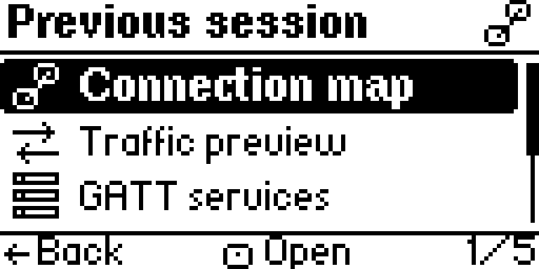
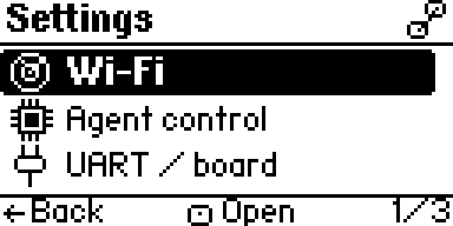
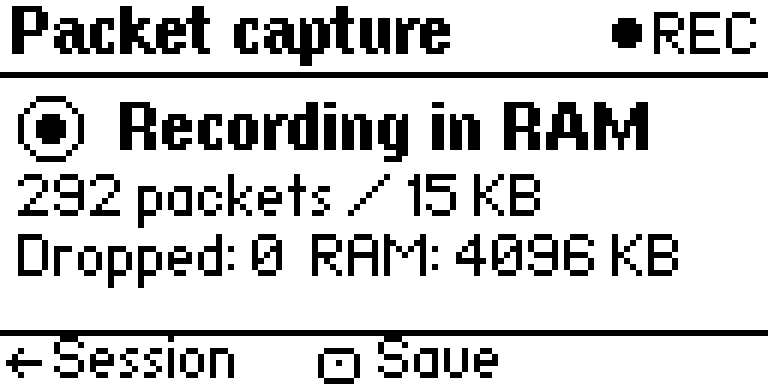
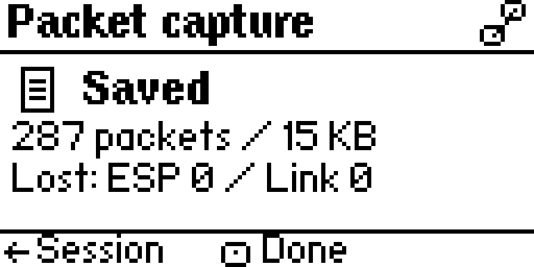

# ESP32-GATTacker for Flipper Zero

ESP32-GATTacker is the Flipper Zero companion app for the
[ESP32-GATTacker firmware](https://github.com/p0px/ESP32-GATTacker) over GPIO UART.
It displays board and device status, configures Wi-Fi, and saves captures to the Flipper SD card.
The ESP32 runs its own firmware and web UI and can also operate independently.

## Screenshots

| Session | Settings |
| --- | --- |
|  |  |

| Recording | Saved capture |
| --- | --- |
|  |  |

## Source layout

`app/main.c` starts the app, and `app/app.h` holds shared state and declarations.
The remaining C code is grouped by purpose:

- `app/capture/`: PCAP recording, browsing, and SD export.
- `app/core/`: packet, wire, and rules helpers.
- `app/link/`: UART transport and board pairing.
- `app/session/`: board state, sessions, and traffic events.
- `app/ui/`: drawing, menus, navigation, and button input.
- `app/wifi/`: network setup and scan results.

## Build and install

Download the app for the firmware installed on your Flipper:

| Flipper firmware | App download |
| --- | --- |
| Official release | [ESP32-GATTacker-official.fap](https://github.com/p0px/ESP32-GATTacker-Flipper/releases/latest/download/ESP32-GATTacker-official.fap) |
| Unleashed release | [ESP32-GATTacker-unleashed.fap](https://github.com/p0px/ESP32-GATTacker-Flipper/releases/latest/download/ESP32-GATTacker-unleashed.fap) |

Copy the `.fap` to `apps/GPIO/` on the SD card and open **Apps → GPIO → ESP32-GATTacker**.
Each binary uses the latest release SDK for its firmware. If your Flipper runs an older version,
build against its matching SDK instead.

Use the uFBT SDK that matches the firmware installed on your Flipper. From the repository root:

```sh
uv tool run --from ufbt==0.2.6 ufbt update --channel=release
uv tool run --from ufbt==0.2.6 ufbt
```

For Unleashed, select its SDK before building:

```sh
uv tool run --from ufbt==0.2.6 ufbt update \
  --index-url=https://up.unleashedflip.com/directory.json --channel=release
uv tool run --from ufbt==0.2.6 ufbt
```

Both commands produce `dist/gattacker.fap`. GitHub Actions builds both variants on pushes and
pull requests. A `v*` tag publishes both binaries in a GitHub Release.

The app requires ESP32 firmware with the Flipper UART bridge. Download it from the
[main firmware repository](https://github.com/p0px/ESP32-GATTacker).

In the app's UART setup, select the pin pair wired to the board and match the board's baud rate.
Connect TX to RX in each direction and connect a common ground.

## Host tests

On Linux with Python 3 and a C compiler:

```sh
python3 -m unittest discover -s tests -v
cc -std=c17 -Iapp/core \
  tests/core_test.c app/core/wire.c app/core/rules.c \
  -o /tmp/gattacker-core
/tmp/gattacker-core
```

Install `tshark` and `capinfos` to include the Wireshark decoding check. GitHub Actions runs the
full suite before publishing a release.

## License

[MIT](LICENSE)
